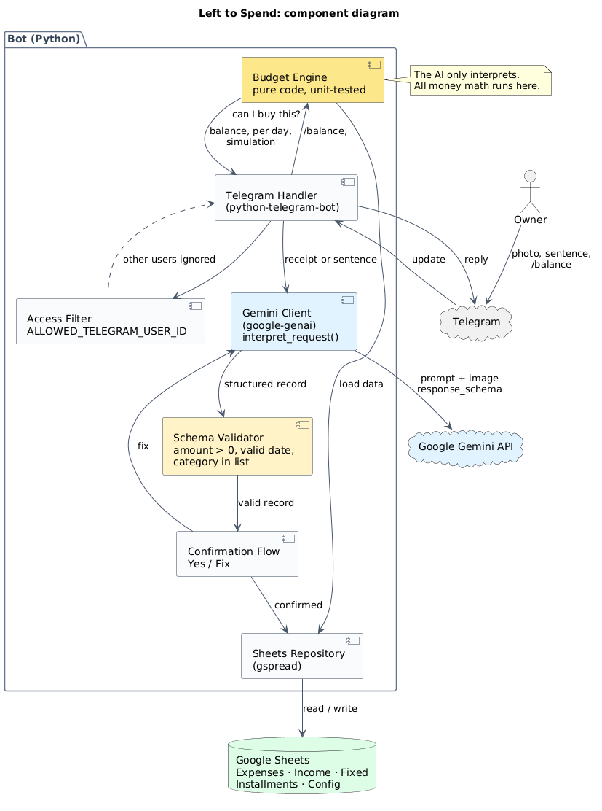
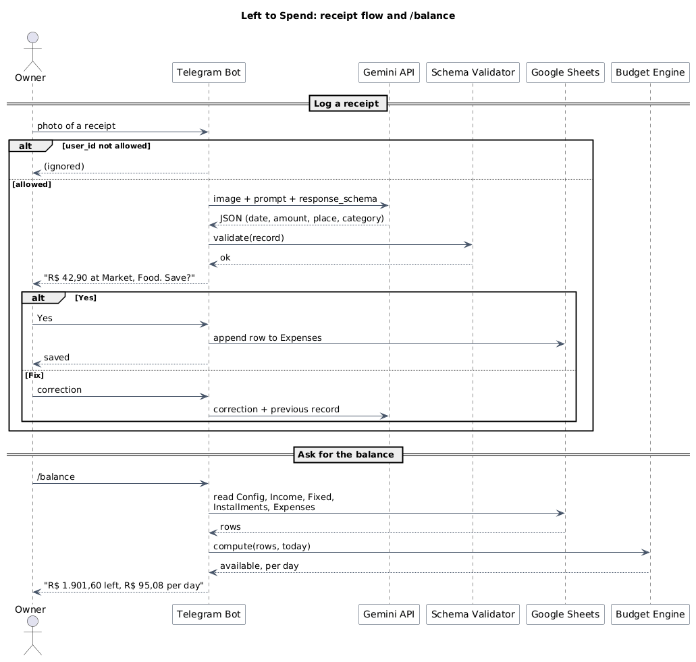

<div align="center">

# Receipt AI Budget

**A self-hosted Telegram bot that reads your receipts with AI, logs them in Google Sheets, and tells you how much you can spend today.**

[](LICENSE)


</div>

Most receipt apps stop at logging. This one answers the everyday question: **"How much can I spend today without breaking my monthly goal?"**

## Features

- **Reads receipts.** Send a photo; the AI extracts date, amount, place and category.
- **Understands sentences.** "Rent 1,200 every 5th", "Invest R$ 500 per month", "Laptop in 10 installments of R$ 300".
- **`/balance`.** Shows what is left for the month and per day.
- **Purchase simulation.** "Can I buy sneakers for R$ 400 in 4 installments?" shows the effect on your daily amount.
- **Always asks first.** Nothing is saved until you press **Yes**. **Fix** lets you correct it.

## How it works



The AI only **interprets** a photo or sentence into a structured record. All money math runs in plain Python with exact `Decimal` values:

```text
available = starting balance
          + income in the budget month
          - investment goal
          - unpaid fixed bills
          - installments due
          - expenses already made

per day   = available / days left in the budget month
```

Example: R$ 500 + R$ 4,000 - R$ 500 - R$ 1,730 - R$ 300 - R$ 68.40 = **R$ 1,901.60**. With 20 days left, that is **R$ 95.08** per day.

<details>
<summary>Sequence diagram</summary>



</details>

## Security and privacy

Financial data is sensitive, so the bot is self-hosted and private by default.

- **Owner only.** Only the Telegram account in `ALLOWED_TELEGRAM_USER_ID` can use the bot. Everyone else is silently ignored.
- **AI output is untrusted.** The bot validates it (positive amounts, known categories, real dates) and you confirm before anything is written. This limits prompt injection.
- **No secrets in git.** `.env` and service account files are git-ignored. Never commit them.
- **Receipts are not stored.** Images stay in memory. The prompt tells the AI to ignore tax IDs, card numbers and addresses.
- **Images go to Google Gemini.** Check Google's [API data terms](https://ai.google.dev/terms) for your tier before you send real receipts.
- **Least privilege.** Share the spreadsheet only with the service account, as editor of that sheet.

Found a vulnerability? See [SECURITY.md](SECURITY.md).

## Quick start

**You need:** Python 3.11+, a bot token from [BotFather](https://t.me/BotFather), a [Gemini API key](https://aistudio.google.com/), and a Google Cloud service account with the Sheets API enabled.

```bash
git clone https://github.com/<your-username>/receipt-ai-budget.git
cd receipt-ai-budget
python -m venv .venv && source .venv/bin/activate   # Windows: .venv\Scripts\activate
pip install -r requirements.txt
cp .env.example .env                                # then fill in your values
python -m app.bot
```

Open your bot on Telegram and send `/balance`.

### 1. Prepare the spreadsheet

Create a Google Sheet with these tabs. The **first row of each tab must be exactly these headers**:

| Tab | Headers |
|---|---|
| `Config` | `key`, `value`. Keys: `starting_balance`, `investment_goal`, `rollover_day` (1 to 28) |
| `Income` | `description`, `amount`, `date`, `recurring` |
| `Fixed` | `name`, `amount`, `due_day`, `paid` |
| `Installments` | `description`, `total`, `count`, `current`, `amount_each` |
| `Expenses` | `date`, `amount`, `place`, `category` |

Dates use `dd/mm/yyyy`. Amounts accept `1.234,56` or `1234.56`. `recurring` and `paid` accept `yes` or `no`. Mark a bill as paid once it has left your account, otherwise it is deducted twice. Then share the sheet with the service account email.

### 2. Configure `.env`

| Variable | Purpose |
|---|---|
| `TELEGRAM_BOT_TOKEN` | Token from BotFather |
| `ALLOWED_TELEGRAM_USER_ID` | Your numeric Telegram id |
| `GEMINI_API_KEY` | Key from Google AI Studio |
| `GEMINI_MODEL` | Gemini model name (see the Gemini docs for current models) |
| `GOOGLE_SERVICE_ACCOUNT_FILE` | Path to the service account JSON, e.g. `./secrets/service-account.json` |
| `SPREADSHEET_ID` | The id in the spreadsheet URL |
| `CATEGORIES` | Comma-separated list, e.g. `Food,Transport,Housing` |

## Usage

| You send | The bot does |
|---|---|
| Photo of a receipt | Logs an expense after you confirm |
| `/balance` | Shows what is left this month and per day |
| "Rent 1,200 every 5th" | Creates a fixed bill |
| "I want to invest R$ 500 per month" | Updates the investment goal |
| "I bought a laptop in 10 installments of R$ 300" | Creates an installment plan |
| "Can I buy sneakers for R$ 400 in 4 installments?" | Simulates it and saves nothing |

The confirmation message flags a suspected duplicate expense (same date, amount and place).

## Development

```bash
pip install -r requirements-dev.txt
pytest --cov=app      # no network or credentials needed
ruff check . && ruff format --check .
```

| Module | Responsibility |
|---|---|
| `app/budget.py` | Budget engine and purchase simulation (pure functions) |
| `app/money.py` | `Decimal` helpers, Brazilian formats, installment splitting |
| `app/validation.py` | Validates AI output into domain objects |
| `app/ai.py` | Gemini behind `interpret_request(input) -> dict` |
| `app/sheets.py` | Google Sheets storage |
| `app/service.py` | Interpret, validate, confirm, save |
| `app/bot.py` | Telegram handlers and owner-only access |

## Limitations

- Blurry, crooked or dark photos can be misread. That is why confirmation exists.
- Dates and amounts follow the Brazilian format.
- One receipt per photo.
- This is a budgeting aid, not financial advice.

## More

[Contributing](CONTRIBUTING.md) · [MIT License](LICENSE)
